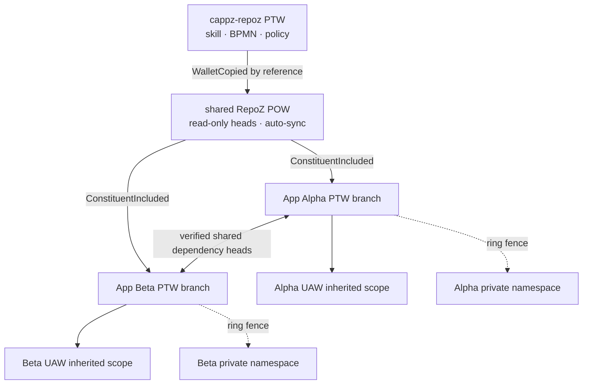

# CAPPZ RepoZ Guide

## Wallet-native architecture

CAPPZ RepoZ is one inherited, wallet-native versioning skill. The `cappz-repoz` Prime Template Wallet (PTW) owns the canonical skill, BPMN, schemas, and policy. Its Prime Operational Wallet (POW) is the shared, auto-synchronizing version network. Platform, app, and User Application Wallet (UAW) branches include the skill by reference.

The shared graph stores version identity, content hashes, dependency edges, conflict and merge evidence, and exact build manifests. Private content bytes remain encrypted inside the platform, app, or user wallet that owns them. RepoZ synchronization uses Replicator peer transport; it is separate from hosted functions and sign-in.



## Permission boundary

- Read access follows the wallet's visible scope.
- Amend is default-deny.
- An amendment requires an active, wallet-verified `AmendGranted` transaction from that app's Administrators group. Grant issuance stays unavailable until its trusted group-replay signer boundary is connected; it cannot be supplied by callers.
- The grant applies from the app branch top node downward and cannot authorize another tenant's branch.
- Grant and revoke commands declare a `governingPrinciple`; `PrinciplesChainlet` verifies the current principle hash and records the invocation.
- The permission function is not exported through the public SDK. Administration remains on the governed internal path.

## Generic lifecycle events

RepoZ does not create document-, media-, or function-specific version event families. It uses:

- `ContentCreated` — genesis of any content-addressed artifact.
- `ContentAmended` — a new version referencing one or more prior heads.
- `ConflictDetected` — immutable evidence that a proposed base diverged from current heads.
- `BranchMerged` — a signed multi-parent convergence event.
- `ConstituentIncluded` and `DependencyCreated` — wallet graph composition.
- `BuildConstituentIncluded` and `BuildManifestCreated` — exact app build versions.

The payload `objectType` distinguishes document, media, function, schema, BPMN, UI, source, and other artifacts. History is never overwritten.

## BPMN

`src/bpmn/substrate/federated-repoz.bpmn` governs the lifecycle:

1. Verify the governing principle hash.
2. Replay the signed app-branch amendment grant.
3. Default-deny ungranted writes.
4. Hash content in the owning wallet.
5. Compare synchronized branch heads.
6. Emit `ContentCreated` or `ContentAmended`; preserve divergence as `ConflictDetected`.
7. Require a signed multi-parent `BranchMerged` to converge conflicts.
8. Replicate verified heads through Replicator Network → Channel → Session.
9. Emit exact build constituents and the app dependency manifest.

## SDK

```ts
import {
  includeRepoZSkill,
  createRepoZContent,
  amendRepoZContent,
  mergeRepoZHeads,
  createRepoZBuildManifest,
} from '@cappz/sdk/repoz';

await includeRepoZSkill(appRoot);
await createRepoZContent({
  appRoot,
  artifactId,
  objectType: 'document',
  contentHash,
  contentAddress,
  actorAddress,
  signature,
});
```

The SDK exposes branch/version operations but not grant creation. Every write still passes the internal replayed amendment guard.

## Build and release evidence

The release guard hashes all shipped source families: application source, plugins, hosted functions, packages, scripts, configuration, process loops, and public machine-readable manifests. A changed source set requires a new SHIPPED milestone. The per-file hashes in the release stamp are the deterministic RepoZ evidence set for that build.

## Original architecture wording

> Each current location of documents have a repoz skill. If the included skill is anchored on a branch of the chain based graph, there is both functional isolation coordinated shared versioned reuse in a distributed manner.  
> Create a single cappz-repoz wallet PTW that includes RepoZ skill.  Because each App and platform PTW holds the RepoZ skill respectively anchored to their sub graph of the ontological blockchain platform graph, any overlapping branches are multi-master version coordinated. Each app builds of specific versions.  App dependencies are traced via Txs within each App PTW. The vin diagram dependency graph made manifest. Each App PTW, PTO, and UAW have the embedded auto-syncing cappz-repoz seeparate from their private namespace encapsulating wallet whereee instance specific private content is strored.

> from the app specific branch top node down. Same scoping as the resident admin agent.  Distributed synchronized and tenant ring-fenced federated development repoz. Need BPMN to capture it all.

PTW means Prime Template Wallet. PTO/POW refers to the operational copy, standardized in CAPPZ as Prime Operational Wallet. UAW means User Application Wallet.

## Migration boundary

The legacy row-based RepoZ service remains read-only compatibility code for existing records until each source has a complete inventory and verified wallet replay. The primary `/cappz-repoz` experience no longer writes through it. No legacy source is retired from an empty result or before its content hash, lifecycle, permission scope, and dependency edges verify in its owning wallet.
## v14-15-00 — RepoZ skill and CAPPZ RepoZ instance

- **RepoZ** is a generic agentic skill built on primitive skills (Notarization, HD paths, Replicator sync, grants). Any platform can use it to create its own equivalent.
- **CAPPZ RepoZ** (`cappz-repoz`) is the RepoZ instance for CAPPZ, also an agentic skill, with access to the full CAPPZ ecosystem. CAPPZ is a platform built on the CAPPZ platform.
- **Optimistic check-ins**: every check-in references the version it changes (`baseVersionTxId`). An author can send `ContentAmendPlanned` (intent) to signal a soft lock to others, with no guarantee of exclusivity. It expires, can be cancelled with `ContentAmendPlanCancelled`, and closes when the author checks in.
- **Code is admin-read only.** Others see path, hash and version.
- **Rendered videos** that are versioned belong to cappz-repoz at `<app-branch>/repoz/media/<artifact>`, not to generic RepoZ.
- **Builds** take a target: `CAPPZ_TARGET_VERSION=<shipped label>` or `vNext`. Parts are tied with `ConstituentIncluded`; the version chip is amended from the target. A rebuild of an existing version emits `BuildAmended`.
- **RepoZ Conflict Remediation**: popup short form with an AI-suggested merge, linking to a full editor with tabs and side-by-side panes (base, mine, theirs, merged) and an agent pane. API: `repoz.diff`, `repoz.suggestMerge`.
- **Public read**: default deny. A `ReadGranted` from `<app>/security/groups/public` (or the CAPPZ platform wallet for platform media) to the artifact or its folder makes it readable.

### Design principle — generic vs specific events (COPE learning)
Default to generic `ContentCreated` / `ContentAmended` with a `kind` discriminator. Derive a context-specific subclass (for example `BuildAmended`) when downstream consumers need precise pub/sub routing or different handling. The consumers' requirements drive the decision. Every subclass names its generic parent so generic replay keeps working.

## v14-16-00 — Build requests, Agent sandbox, code in wallets (shadow)
- **BuildRequested → ConstituentIncluded**: each build-log task sends `BuildRequested` from the task address to the build version address (or vNext). The build is the arbiter: for every task it accepts, it sends `ConstituentIncluded` from the build version address to the task, using the same correlationId. A task never states its own inclusion.
- **Design principle**: pick the event from the roles at each end. In a request → decision, the requester sends `XRequested` and the decider replies. Fire-and-forget states a fact. The sender is the actor; the receiver is the subject.
- **Conflict Remediation Agent sandbox**: one shared editable draft that you and the agent take turns on, with draft history. A sample writers-contract message loads when no conflict is supplied.
- **Code in wallets, stage 1**: every source file gets an address at `<app>/repoz/code/<path>` and a hash. GitHub drift is reported, not blocking. The export cascades down `ConstituentIncluded` edges and never enters unreadable namespaces.

## v14-16-03 — Storage compaction, trusted grant signer, export

**RepoZ summary:** RepoZ versions content with generic Content* events; the original content address is the identity. Compression and archive never create a new version.

Archive is Replication plus a purge — no new infrastructure. `archive-content.bpmn` runs the Replicator's own `a2a-sync` flow inside it. Three notarized TXs, in order:
1. `ContentCompressed` — source address → HD child `<contentAddress>/compressed/gzip` (alias, same identity), carrying raw + compressed hashprints.
2. `ContentArchived` — source address → the offline archive wallet address, from a verified one-way Replicator checksum receipt.
3. `ContentPurged` — intra-wallet accounting TX from the AgentAdmin address → the original address, last, only after 1 and 2 and a typed wallet-root confirmation. The original becomes a `<contentPurged>` placeholder that never replicates. Restore = replicate back from the archive.

Skill graph (acyclic): Store engine, Notarization, Compression ← Replicator ← Archive ← cappz-store.

- **Trusted signer**: an admin sends `GrantRequested` signed by their wallet; the signer replays Administrators-group membership, verifies the signature and branch scope and replies with the grant or `GrantRejected` (mainnet needs two admins).
- **Wallet Contents Viewer** (Admin → Storage): account/address tree, compression state, permissions, versions, relations graph, prescan estimates, compress / free-up-space, export ZIP (`ContentExported`).

## v14-16-04 — Lazy reads and archive activation

- **Lazy decompress (decompress only on a cache hit):** the index and metadata load on boot; code and documents stay gzip-compressed in memory and are unzipped, hash-checked, only when opened (`lazyContent`), then kept in the hot cache. Untouched content costs no memory or CPU.
- **Archive activation (v14-16-04):** the Archive button checks every platform/app wallet for an archive replica; missing ones are created with `ReplicantCreated` + derived `ArchiveCreated` (same correlationId), then archive-content.bpmn runs. Only deltas are archived: content with no `ContentArchived` TX.
