# Constraint Guard: keep physical systems inside their safe envelope



**In one minute.** Most attacks on equipment are not exotic. Someone reaches a control panel, a vendor's remote-access path or an unauthenticated protocol, and changes a setpoint. A freezer is driven to +50 °C, a dosing pump is told to add a hundred times more chemical, or a breaker is opened. Often the same access also changes what the controller records, so nobody notices for hours.

The Constraint Guard gives you three things:

| | What it is | What it does | Risk to operations |
|---|---|---|---|
| **Envelope** | A signed file per device: its limits, and who may change what | Defines "allowed" | None |
| **Reconciliation** (detect) | A read-only check over data you already have | Finds every change nobody authorised and every value outside the limits, within minutes | None: it never touches the controller |
| **Guard** (prevent) | A check on the network path in front of the controller | Refuses unauthorised or unsafe writes, using the protocol's own "refused" reply | Starts in shadow (forwards everything, only records); you enforce point by point when its report says ready |

It works for any device with setpoints: freezers, ovens, HVAC, dosing pumps, breakers, doors, IoT devices, and device twins kept in a graph database. It speaks HTTP, Modbus TCP, BACnet/IP, DNP3, IEC 60870-5-104, MQTT (with Sparkplug B) and Gremlin (Apache TinkerPop). It needs no CAPPZ account and no cloud service: everything runs on your own machine or on the CAPPZ edge node.

## Start here

| You want to | Go to |
|---|---|
| See the whole idea in two minutes | The animated walkthrough: open [tutorials/constraint-guard.html](tutorials/constraint-guard.html) in a browser (from a clone, or download the file; it works offline) |
| Try it on example data, changing nothing | [Quick start](#quick-start), steps 1 and 2 (about 10 minutes) |
| Find out whether someone already changed a setpoint | [Reconciliation](#reconciliation) |
| Protect a controller | [Quick start](#quick-start), steps 3 and 4, then [the guard](#the-guard) and its [configuration](#configuration) |
| Understand why a write was refused | [Refusal reasons and what to do](#refusal-reasons-and-what-to-do) |
| Fix a problem | [Troubleshooting](#troubleshooting) |
| Know where you are in a rollout | `constraint-wizard` with no step prints what is done and the next step |
| Hand it to an AI agent | The skills [securing-control-systems](../skills/securing-control-systems/SKILL.md) and [monitoring-constraints](../skills/monitoring-constraints/SKILL.md), or `cappz-market skills "oven setpoint hacked"` to find them |

**Contents:** [Words used here](#words-used-here) · [Quick start](#quick-start) · [The envelope](#the-envelope) · [Commands](#signed-and-armed-commands) · [Reconciliation](#reconciliation) · [The guard](#the-guard) · [Refusal reasons](#refusal-reasons-and-what-to-do) · [Troubleshooting](#troubleshooting) · [Graphs](#device-twins-in-a-graph-apache-tinkerpop) · [Marketplace agents](#marketplace-agents) · [Vehicles](#vehicles-advisory-only) · [Limits](#what-it-does-not-do)

---

## Words used here

| Word | Meaning |
|---|---|
| **Point** | One thing on a device: a measured value (`measurement`), a setting (`setpoint`), an on/off output (`command`) or the operating mode (`state`). Example: `oven-3/setpoint`. |
| **Envelope** | The device's signed rule file: its points, their limits (constraints) and who may change them. Versions are numbered; each one names the version it replaces. |
| **Constraint** | One rule in the envelope, such as "setpoint between 160 and 250 °C" or "the two probes agree within 6 °C". |
| **Operator** | A person whose key may sign envelopes and switch the guard's modes. Loosening a rule needs two operators. |
| **Signed command** | A request to set one point to one value, signed by a key the envelope allows, valid for at most 15 minutes, usable once. |
| **Armed command** | A signed command handed to the guard in advance, for protocols that cannot carry a signature (Modbus, BACnet, DNP3, IEC 104, MQTT, Gremlin). The next matching write uses it up. |
| **Shadow / enforce** | In shadow the guard forwards everything and records what it would have refused. In enforce it refuses. Modes are set per point. |
| **Orphan change** | A setpoint that changed with no authorised command to account for it. This is the key detection signal. |
| **Sealed observations** | Readings signed and chained by the collector as they arrive, so later edits to the history show. |

## Quick start

### Prerequisites

1. **Deno 2** (`curl -fsSL https://deno.land/install.sh | sh`).
2. **A copy of the SDK**: `git clone https://github.com/CAPPZ-ai/cappz-sdk && cd cappz-sdk`.
3. For the inline guard only: a machine on the network path to the controller. That can be the CAPPZ edge node, a small Linux board, or any computer that clients reach instead of the controller.

The example files used below are in [`packages/cappz-sdk/examples/constraints/`](../packages/cappz-sdk/examples/constraints/). They describe a bakery oven, `oven-3`:

| File | What it is |
|---|---|
| `envelope-draft.json` | The oven's points and limits, to declare as its envelope |
| `constraints.json` | Guard configuration: which controller, which protocols, which register or topic is which point |
| `historian.csv`, `historian-map.json` | A historian export (one row per reading) and the map from its tag names to points |
| `setpoints.csv`, `setpoints-tampered.csv`, `readback-map.json` | Setpoints read back from the controller: normal, and with an unauthorised change |
| `graph-mapping.json` | How to read a device graph, for `draft-graph` |

### Step 1: declare the envelope (5 minutes)

```sh
T=packages/cappz-edge-node/tools
E=packages/cappz-sdk/examples/constraints
deno run -A $T/constraint-wizard.ts keygen                          # prints your operator public key
deno run -A $T/constraint-wizard.ts init --envelope-id site-17/oven-3
cp $E/envelope-draft.json cappz-constraints/
# Edit cappz-constraints/envelope-draft.json: replace REPLACE-with-the-technician-public-key-hex
# with the public key of whoever may change the setpoint (to try it out, your own key).
deno run -A $T/constraint-wizard.ts declare                         # → "declared site-17/oven-3 version 1 … active now"
deno run -A $T/constraint-wizard.ts status
```

If you forget the placeholder, `declare` refuses and says which key to replace.

### Step 2: detect, with no change to the control system

```sh
deno run --allow-read --allow-write $T/constraint-reconcile.ts \
  --config cappz-constraints/constraints.json --data cappz-constraints/data \
  --observations $E/historian.csv --mapping $E/historian-map.json \
  --config-readback $E/setpoints.csv --readback-mapping $E/readback-map.json --out report.json
```

```text
CLEAN: no setpoint changed; every value stayed in the envelope
integrity: unsealed — observations were not sealed at the collector: a tampered historian would not show
```

Now run it on `setpoints-tampered.csv` (someone set the oven to 400 °C at 04:07):

```text
FINDINGS: 3 finding(s): 1 change(s) without an authorised command, 0 unauthorised command(s), 2 envelope breach(es), …
  2026-11-02T04:07:00.000Z  orphan-change        oven-3/setpoint: 200 → 400 Cel with no authorised command in the 10 min before it — changed outside the governed path
  2026-11-02T04:07:00.000Z  out-of-envelope      oven-3/setpoint [setpoint-range]: outside 160…250 Cel (still outside at the end of the data), worst 400 Cel
  2026-11-02T04:07:00.000Z  out-of-envelope      oven-3/setpoint [setpoint-step]: a setpoint step of 200 Cel exceeds 20 Cel
```

The exit code is 0 for clean, 1 for findings and 2 for gaps only, so a scheduler can alert on it. To use your own data, write a map for your historian's export, as in `historian-map.json`.

### Step 3: the guard, in shadow

1. Copy `constraints.json` into `cappz-constraints/`.
2. Point `upstream` at your controller and fix the maps (see [Configuration](#configuration)).
3. Put both operators' public keys in `trustedOperators`.
4. Run `doctor`.
5. Start the edge node:

```sh
deno run -A $T/constraint-wizard.ts doctor                          # must end with "doctor: ok"
CAPPZ_CONSTRAINTS_CONFIG=cappz-constraints/constraints.json CAPPZ_NODE_DATA=cappz-constraints/data \
  deno run -A --unstable-net packages/cappz-edge-node/main.ts
```

Then point the HMI, building management system or integration at the guard's port instead of the controller. Everything still works: in shadow the guard forwards every request and writes its verdicts to `cappz-constraints/data/constraint-verdicts.jsonl`.

Optionally, set `CAPPZ_NODE_KEY` and `CAPPZ_NODE_PUB` (an Ed25519 key, e.g. from `constraint-wizard keygen --dir node-key`, split at the colon) so the guard seals what it observes.

### Step 4: move people to signed commands, then enforce

- **Web panels and REST:** send the `Cappz-Command` header that `constraint-wizard command --point oven-3/setpoint --value 215` prints.
- **Other protocols:** arm the command first with `constraint-wizard command --point oven-3/setpoint --value 215 --arm http://guard:41452`, then write as usual.
- **When the report says a point is ready** (`GET http://guard:41452/cappz/constraints/report`, or `cappz-market constraints-review --guard http://guard:41452`), enforce that point:

  ```sh
  deno run -A $T/constraint-wizard.ts enforce --point oven-3/setpoint --report http://guard:41452 --reason "shadow clean for 14 days"
  ```

- **To roll back:** `constraint-wizard shadow --point oven-3/setpoint --reason "…"` takes effect within seconds.

To check everything on your own machine with real sockets for every protocol: `deno run -A --unstable-net $T/constraint-selftest.ts`.

---

## The envelope

### Points

| Field | Required | Meaning |
|---|---|---|
| `id` | yes | Stable name, e.g. `oven-3/setpoint`. Never parsed for meaning. |
| `kind` | yes | `measurement`, `setpoint`, `command` or `state` |
| `unit` | yes | A UCUM code: `Cel`, `[degF]`, `K`, `kPa`, `bar`, `[psi]`, `%`, `mg/L`, `[ppm]`, `[pH]`, `m/s`, `[kn_i]`, `[ft_i]`, `V`, `A`, `kW`, `Hz`, `L/min`, `s`, `min`, `{bool}`, `{state}` … (full list in `src/lib/constraints/units.ts`). Values in other units are converted before comparing; units that don't convert are reported, never guessed. |
| `maxGapMs` | no | The longest silence allowed; a longer one is reported as `stale` |
| `failMode` | no (setpoints) | What the guard does if it cannot decide (for example, it cannot read the envelope): `hold-last-good` (default: refuse; the controller keeps its last good value) or `pass-and-alarm` (forward and alarm). Choose `pass-and-alarm` only where withholding a write is more dangerous than allowing it. |

`modePoint` names a `state` point holding the operating mode. A constraint with `modes: ["baking"]` applies only in those modes. While the mode is unknown, such constraints refuse; they are never skipped.

### Constraints

| Kind | Fields | Checks | Example |
|---|---|---|---|
| `range` | `min` and/or `max`, `unit` | Stays within limits | Oven setpoint 160–250 `Cel` |
| `rate` | `maxStep` (setpoints) or `maxDelta` + `perMs` (measurements), `unit` | Size of a setpoint change, or speed of change | At most 20 °C per change |
| `dwell` | `min`/`max`, `maxMs`, `unit` | Time spent outside a band | Not above 250 °C for over 10 min |
| `agreement` | `points` (2+), `tolerance`, `unit`, optional `maxSkewMs`, `persistMs` | Redundant sources agree; with a majority, the outlier is named | Control probe vs independent probe within 6 °C |
| `response` | `points: [setpoint, value]`, `withinMs`, `deadband`, optional `minChange` | A change takes effect, in the right direction | Value reaches the new setpoint within 15 min |
| `authority` | `grants: [{ publicKey, points, windows?, wallet? }]` | Who may command which points, and when | Only the technician's key, 04:00–20:00 |
| `schedule` | `windows: [{ days, from, to, utcOffsetMin? }]` | When points may be written at all | No breaker operations outside switching windows |

Days run 0 (Sunday) to 6; times are `HH:MM`; windows may cross midnight. Every constraint has an `id` and `points`, and may have a `note` (e.g. the manual section it comes from).

### Changing an envelope

- **Tightening** a limit (or adding one) takes effect as soon as one operator declares it.
- **Loosening** anything needs a second operator (`constraint-wizard endorse --hash …`) and then waits a cooling period (default 72 hours). `declare` lists each loosening in plain words, and `endorse` shows them again before you approve. Loosening includes:
  - a wider range or faster rate
  - a new key or longer window
  - a removed rule or a weaker fail mode
  - a shorter cooling period, or a revocation
- **History is never overwritten.** Each version names the one it replaces. Forks, edited files and future-dated versions are refused.

## Signed and armed commands

A command is authorised only when all of these hold:
- its signature checks out and it is within its time limit
- it has not been used before
- an `authority` grant allows that key to set that point now (and, when the grant names a wallet, that wallet's KeyZ key declaration is valid and not revoked)
- any `schedule` is open
- the value is inside every `range`, and the change is within every `maxStep`

Reconciliation applies exactly the same check after the fact. The guard logs each write together with the command it used, so reconciliation re-checks every guarded write on its own.

## Reconciliation

| Finding | Meaning | Typical cause |
|---|---|---|
| `orphan-change` | A setpoint changed and no authorised command accounts for it | An exposed panel, vendor remote access, a shared password |
| `unauthorized-command` | A logged command fails the check | Unsigned sender, revoked key, replay, out of hours, out of range |
| `out-of-envelope` | A range, rate or dwell breach (once per episode, with the worst value) | An unsafe change or a process upset |
| `disagreement` | Redundant sources disagree | Sensor fault or icing, or a falsified reading |
| `no-response` | A change had no effect, or the value moved the wrong way | Stuck actuator, manual override, falsified reading |
| `stale` | A point went silent too long | Communication loss, or something hidden |
| `unmapped`, `outside-coverage`, `not-evaluated` | **Gaps.** Something could not be checked. | Map the tag, fix the export, extend the data |

**A period with gaps is never "clean".**

| Option | Use |
|---|---|
| `--observations f --mapping m` | Historian export (CSV, or JSON rows). Map `format: "long"` (time, tag, value, unit, quality) or `"wide"` (one column per tag). Tags not in the map are listed, never guessed; quality text like `Bad` or `Comm Failure` marks a reading bad. |
| `--config-readback f --readback-mapping m` | Setpoints read back from the controller. These are what reveal orphan changes. |
| `--sealed f --collectors <key>` | Sealed batches from the guard. An edited, missing or reordered batch is reported as `sealed-broken`. |
| `--commands <verdicts.jsonl>` | The guard's verdict log. Each command in it is re-verified. |
| `--from`, `--to` | The period (ISO times) |
| `--envelope f` | Use a signed envelope file instead of `--config` + `--data` |

A seal proves the record has not been changed since it was collected. It does not prove the sensor was right; an `agreement` with an independent sensor does that.

## The guard

### Protocols

| Front | What it reads | How it refuses | Typical equipment |
|---|---|---|---|
| `http` | Routes like `PUT /api/v1/points/{id}/setpoint`, value at a JSON Pointer | HTTP 403 with the reasons | Controller web panels, vendor APIs |
| `modbus` | Writes to coils and holding registers (functions 5, 6, 15, 16, 22, 23); 16/32-bit and float values, scaling | Modbus exception 03 (01 for refused functions) | PLCs, refrigeration and HVAC controllers |
| `bacnet` | WriteProperty, WritePropertyMultiple (incl. priority, relinquish) | BACnet error: security / write-access-denied | Building automation |
| `dnp3` | SELECT, OPERATE, DIRECT_OPERATE of relay outputs and analog outputs | The same objects returned with NOT_AUTHORIZED | Water and electric utilities |
| `iec104` | Single/double commands and setpoints, with or without time tags | Negative activation confirmation; sequence numbers stay consistent | Substations, grid control |
| `mqtt` | Command topics (exact or `+`/`#` filters); Sparkplug B NCMD/DCMD | MQTT 5: "not authorized" (0x87). MQTT 3.1.1: connection closed (QoS 1/2) or message dropped (QoS 0) | IoT devices, edge gateways |
| `gremlin` | Bytecode traversals `V(<ids>)…property(key, value)` | Gremlin status 401 | Device twins in JanusGraph, Neptune, Cosmos DB … |

Refused without a point to check:
- **Privileged operations**, unless you list them in `allowPrivileged` by the name the guard reports (e.g. `"ReinitializeDevice"`, `"Modbus function 90"`): restarts, file transfer, creating or deleting objects, communication control, Gremlin scripts, lambdas, `drop()` and `addV()`.
- **Damaged frames**, and requests split into segments that cannot be checked whole.
- **Writes to anything the map does not cover** (unless `allowUnmapped`).
- **For Gremlin:** setting a guarded property on vertices not chosen by literal id (a bulk write).

**OPC UA binary** is normally signed and encrypted end to end, so nothing in the middle can read it, by design. Guard OPC UA at its PubSub JSON or REST layer, or have clients sign commands.

### Configuration

`cappz-constraints/constraints.json`. A complete example: [`examples/constraints/constraints.json`](../packages/cappz-sdk/examples/constraints/constraints.json). Add only the fronts you need.

| Key | Meaning |
|---|---|
| `envelopeId`, `trustedOperators`, `minRelaxSigners` | Which envelope; operators' public keys; signers needed to loosen (default 2) |
| `host` | Address the fronts listen on (default `127.0.0.1`) |
| `http` | `{ port, upstream: "http://controller", routes: [{ method, path, point \| { param, map }, value: "/json/pointer", unit? }] }` |
| `modbus` | `{ port, upstream: "host:502", map: [{ unitId, table: "holding"\|"coil"\|"input"\|"discrete", address, point, type?: "int16"\|"uint16"\|"int32"\|"uint32"\|"float32"\|"bool", wordOrder?, scale?, offset? }] }` (addresses are 0-based protocol addresses) |
| `bacnet` | `{ port, upstream: "host:47808", map: [{ objectType, instance, property?: 85, point }] }` (object types: analog-value 2, analog-output 1, binary-output 4, multi-state-value 19 …); needs `--unstable-net` |
| `dnp3` | `{ port, upstream: "host:20000", map: [{ outstation, table: "analog-output"\|"binary-output"\|"analog-input"\|"binary-input"…, index, point, scale? }] }` |
| `iec104` | `{ port, upstream: "host:2404", map: [{ ca, ioa, point, scale? }] }` |
| `mqtt` | `{ port, upstream: "broker:1883", topics: { "<topic or filter>": { point, valuePath?, timePath?, unit?, command? } }, sparkplug?: { map: { "<group>/<edge>/<device>/<metric>": point } } }` |
| `gremlin` | `{ port, upstream: "ws://host:8182/gremlin", map: [{ vertexId, key, point }] }` |
| `allowPrivileged`, `allowUnmapped` | Exceptions to the refusals above (default none) |
| `gate` | When a point is ready to enforce: `minWrites` (20), `minDays` (7), `minCleanWrites` (10: the most recent writes must all pass) |

Files the guard keeps in its data directory:

| File | Contents |
|---|---|
| `constraint-envelopes.jsonl` | Envelopes, endorsements, revocations (written by the wizard) |
| `constraint-modes.jsonl` | Per-point shadow/enforce records |
| `constraint-key-evidence.json` | Optional KeyZ declarations and revocations for grants that name a wallet |
| `constraint-verdicts.jsonl` | Every write decision |
| `constraint-alerts.jsonl` | Refusals, fail modes, privileged attempts: feed this to your alerting |
| `constraint-observations.jsonl` | Sealed readings |
| `constraint-shadow.json` | The shadow statistics, kept across restarts |

## Refusal reasons and what to do

| Reason | Means | Do |
|---|---|---|
| `unsigned` | The write carried no signed or armed command | Move that sender to signed commands, or arm them |
| `not-granted` | The key is not allowed to set that point | Add a grant (a loosening: two operators), or stop that sender |
| `outside-window`, `outside-schedule` | Out of allowed hours | Confirm with the person responsible |
| `out-of-range`, `step-too-large` | Unsafe value or change | Treat as an attempted unsafe change until shown otherwise; never loosen to make it pass |
| `mode-unknown` | The mode wasn't known when the write arrived | Make sure the mode point is read through the guard or exported |
| `expired`, `not-yet-valid` | Command used too late, or a clock is wrong | Check the sender's clock (GNSS time can be spoofed) |
| `replayed`, `bad-signature`, `value-mismatch`, `key-revoked` | **Credential signals:** someone captured, forged or kept using signing material | **Investigate before enforcing.** Find the source in the verdict log; revoke keys in their wallets. |
| `key-undeclared` | The grant names a wallet, and that wallet has no valid KeyZ declaration of this key for signing | Have the wallet declare the key, or remove the wallet from the grant |
| `wrong-envelope` | The command was signed for another device's envelope | An operator mistake, or a command reused across sites: find out which |
| `unit-mismatch` | The written value's unit doesn't convert to the point's unit | Fix the map's scaling or the point's unit |
| `unmapped` | The target isn't in the map | Map and declare it, or confirm it isn't needed |
| `privileged` | Not a point write (restart, file transfer …) | Allow by name only if it is part of normal operation |
| `malformed` | A damaged or unreadable request | A broken client, or someone probing |
| `evidence-unavailable` | The guard couldn't read its envelope; the point's fail mode applied | Check the data directory and permissions |
| `advisory-envelope` | The envelope is advisory (e.g. a vehicle's) | Advisory envelopes never authorise writes |

## Troubleshooting

| Symptom | Cause and fix |
|---|---|
| `declare` says a key "is not a 64-hex Ed25519 public key" | A placeholder is still in the draft. Paste the key `keygen` printed. |
| `doctor` says loosening needs 2 operators but only 1 is trusted | Add a second operator's public key to `trustedOperators`; otherwise no limit could ever be loosened. |
| `doctor` says a map names a point the envelope doesn't declare | Fix the point id in the map, or add the point to the envelope and declare a new version. |
| Every write is refused as `unsigned` in shadow | Expected until senders use signed or armed commands. Shadow is where you find this out safely. |
| Reconciliation says `gaps-only` | Some data could not be checked. Read the `unmapped` / `outside-coverage` / `stale` lines and fix the map or the export. |
| BACnet front not started | Run the edge node with `--unstable-net` (BACnet uses UDP). |
| Gremlin clients get 401 for every write | They send scripts (`op: eval`). Send bytecode (the default in the official Gremlin drivers). |

## Device twins in a graph (Apache TinkerPop)

- **Guard:** the `gremlin` front, as above.
- **Observations:** GraphSON vertices, with a timestamp meta-property (default `ts`) per value.
- **Draft an envelope from the graph:**

  ```sh
  deno run -A $T/constraint-wizard.ts draft-graph --vertices vertices.json --edges edges.json --mapping $E/graph-mapping.json
  ```

  - Point vertices come from their labels (`pointLabels`); units and limits come from named properties.
  - `redundantWith` edges become `agreement` constraints, and `controls` edges become `response` constraints.
  - Whatever the graph does not state is listed as needed, never invented.
  - You still add the `authority` constraint yourself.

## Marketplace agents

The CAPPZ check service runs three paid agents, through the `cappz-market` tool. They hold no keys and never reach a controller.

| Command | Price | Input → output |
|---|---|---|
| `cappz-market constraints-draft --file manual.txt --device oven-3` | 0.05 XRP | Manual or datasheet text → a draft envelope. A limit is kept only if its quote appears in your text verbatim with all its numbers; anything dropped is listed with the reason. Who may command what is never drafted. |
| `cappz-market constraints-review --guard http://guard:41452` | 0.02 XRP | Shadow report → per point: enforce now (with the exact command), keep shadowing, or investigate first |
| `cappz-market constraints-triage --report report.json` | 0.02 XRP | Reconciliation report → severity, what the findings most likely mean (marked strong or possible), and ordered actions: contain, preserve, verify, recover, notify |

Reports must be sent unchanged: their `reportHash` is checked before any job opens. Every answer is signed.

Agents find these services, with a link to the skill for each, in the marketplace's discovery document (`https://cappz.ai/.well-known/cappz-market.json`, under `services`: `envelopeDrafter`, `shadowReviewer`, `incidentTriage`) and on the check service's agent card (`https://check.cappz.ai/.well-known/agent-card.json`).

## Vehicles (advisory only)

`src/lib/constraints/vehicle.ts` turns position and clock fixes into points the same engine checks:

| Signal | Catches |
|---|---|
| Distance between position sources (GNSS, inertial, radio navigation, AIS) | GNSS spoofing that walks the position off course |
| Each source's distance to its closest other source (needs 3+ sources) | Names the spoofed source |
| Speed implied by a source's own fixes | GNSS "jumps" |
| GNSS time vs the vehicle's own clock | Time spoofing |
| `agreement` across redundant air data | Unreliable airspeed (iced pitot probes, as in AF447). When two probes fail together, the "majority" can be wrong: check a third reference. |

These envelopes are always advisory, and the guard never uses them to authorise writes. Realistic uses:
- post-flight or post-voyage analysis
- an advisory display on an electronic flight bag or bridge system
- ground monitoring

Anything installed on an aircraft is certified separately (e.g. DO-178C, DO-326A) by whoever installs it. Every threshold is the operator's; none is built in.

## What it does not do

- It protects only writes that pass through it. Close or front every other path: vendor cloud access, VPNs, a second network port.
- A refusal only withholds a write. It never makes equipment act, and local or manual controls never pass through it.
- It is not a safety instrumented system (IEC 61511), and it does not belong in a vehicle's control loop.
- It cannot fix a vendor's vulnerability.
- The honest claim is "unauthorised changes refused, tampering detected within minutes". Not "hacking prevented".
