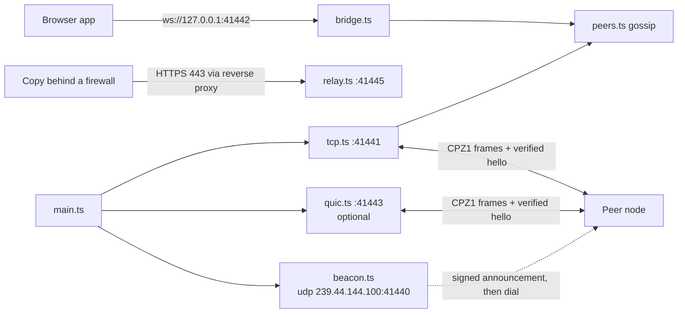

# cappz-edge-node

Standalone CAPPZ Replicator edge node — runs the sync protocol without a
browser. Deno first; the frame codec is shared with the web app, so a node
and a browser speak the same bytes.

## What it does

- **Node key** (`nodeKey.ts`) — one Ed25519 key (`CAPPZ_NODE_KEY` = PKCS8
  base64, `CAPPZ_NODE_PUB` = raw hex) signs the node's hello (fresh per
  connection), its UDP beacons and its TX log. Without it, peer sessions,
  beacons and jobs stay off and the node says why.
- **TCP listener/dialer** (`tcp.ts`) — Bitcoin-style peer sessions using the
  shared `CPZ1` length-prefixed frame codec (`src/lib/sync/frameCodec.ts`).
  Every connection opens with a signed `hello` / `hello-ack`. The peer's
  Ed25519 signature is verified (`src/lib/sync/helloSignature.ts`): unsigned,
  tampered, stale (>10 min) and — with `CAPPZ_PEER_REQUIRE_BOUND=1` —
  undeclared keys are dropped. A peer whose wallet signed a key declaration
  (`src/lib/sync/helloKeyDeclaration.ts`) counts as declared with no file.
  A verified session runs inventory gossip and body pull (`peers.ts`,
  `src/lib/sync/edgeBodyPull.ts`): `inv` announces held ids, `getdata` asks
  for missing ones, `frame` carries each body, and the receiver checks every
  body against its sha256 id before storing it. Heads, delivered and
  rejected bodies are recorded in `peer-txs.jsonl`.
- **Member record** (`directory.ts`) — the node's entry in the network's
  member table: where it accepts connections (`CAPPZ_NODE_LAN_URL` with
  `CAPPZ_NODE_LAN_ID`, `CAPPZ_NODE_PUBLIC_URL`), signed with the node key.
  It is stored as a body, so peer sessions replicate it, and it rides every
  connect offer (the node answers for itself). Copies dial the node
  directly from their table; a relay is only for copies that cannot reach it.
- **Body store** (`objects.ts`) — content-addressed bodies in
  `<CAPPZ_NODE_DATA>/objects/<sha256>`. Files dropped into
  `<CAPPZ_NODE_DATA>/inbox/` are hashed and moved in every 30 s.
- **UDP LAN beacon** (`beacon.ts`) — multicast announcements on
  `239.44.144.100:41440` ("I hold heads for wallet X"), signed with the node
  key. Listeners drop unsigned, forged and stale beacons; a verified beacon
  makes the node dial the peer over TCP. Needs `--unstable-net`. LAN only:
  routers and corporate proxies drop multicast.
- **WebSocket bridge** (`bridge.ts`) — the browser app connects to a local
  node over `ws://127.0.0.1:41442` and opens the same verified hello session
  as a TCP peer.
- **Relay** (`relay.ts`, `--relay 41445`) — for copies behind firewalls and
  reverse proxies: TX bid/ask rendezvous, then the fastest carrier the
  copy's network allows: WebTransport (HTTP/3 over QUIC on UDP 41445, needs
  the TLS pair and `--unstable-net`), WebSocket (`/cpz1/ws`), an HTTPS
  keep-alive stream, then long-poll. Hellos are verified; the ticket
  travels in `Authorization: Bearer` (HTTPS) or the first `auth` frame
  (sockets), never in the URL; open tickets are
  capped per wallet (`CAPPZ_RELAY_MAX_TICKETS_PER_WALLET`, default 8) and in
  total (`CAPPZ_RELAY_MAX_TICKETS`, default 10000). Decisions go to
  `relay-txs.jsonl`. The header of `relay.ts` has the nginx config.
- **QUIC** (`quic.ts`) — UDP-based, reliable, encrypted, NAT-friendly. Same
  frames and verified hello as TCP (shared `src/lib/sync/edgeSession.ts`).
  Uses `Deno.QuicEndpoint` (Deno 2.x removed `Deno.listenQuic`, which had
  left QUIC peering silently off).
  Needs `--unstable-net` and `CAPPZ_TLS_CERT` / `CAPPZ_TLS_KEY` (self-signed
  is fine — trust is the signed hello). Falls back to TCP otherwise.
- **Jobs** (`jobs.ts`, `--jobs 41444`) — BPMN timers and secret-free webhooks.
- **Read-only XRPL connector** (`src/lib/sync/connectors/xrplPeerConnector.ts`)
  watches validated ledger headers and verifies anchors. Never submits. It is
  shipped through `@cappz/sdk` (`src/sdk/transports.ts`); `main.ts` does not
  start it yet.

## Run

```bash
# once: make the node key
node -e 'crypto.subtle.generateKey({name:"Ed25519"},true,["sign"]).then(async k=>{
  console.log("CAPPZ_NODE_KEY="+Buffer.from(await crypto.subtle.exportKey("pkcs8",k.privateKey)).toString("base64"));
  console.log("CAPPZ_NODE_PUB="+Buffer.from(await crypto.subtle.exportKey("raw",k.publicKey)).toString("hex"))})' > node.env

set -a; . ./node.env; set +a
CAPPZ_POW=<pow-wallet-address> CAPPZ_NODE_DATA=./cappz-node-data \
CAPPZ_TLS_CERT=cert.pem CAPPZ_TLS_KEY=key.pem \
  deno run --allow-net --allow-read --allow-write --allow-env \
  --allow-run=curl --allow-sys=networkInterfaces --unstable-net \
  main.ts --tcp 41441 --quic 41443 --ws 41442 --jobs 41444 --relay 41445 \
  --verify 41446 --legacy 41447 --ftps 41449 --ldap 41389
```

v15-09-00 (details: [docs/IDENTITY_TRUST_TRANSPORTS.md](../../docs/IDENTITY_TRUST_TRANSPORTS.md)):

- **TLS without PEM files:** `CAPPZ_TLS_AUTO=1` (instead of `CAPPZ_TLS_CERT/KEY`) makes an
  in-memory P-256 certificate valid 13 days, delegated by the node key; set
  `CAPPZ_WALLET_ADDRESS` (the wallet that declared the node key) and `CAPPZ_TLS_DNS`. The
  WebTransport hash is offered automatically. Restart within 13 days to rotate.
- **KeyZ Gate** (`--verify`, loopback; the verify gateway): nginx `auth_request` or proxy mode
  (`CAPPZ_VERIFY_UPSTREAM`); evidence from `key-declarations.json`, `key-revocations.json`,
  `key-delegations.json` in `CAPPZ_NODE_DATA`. Config in `verifyGateway.ts`.
- **DMZ quarantine + legacy front end** (`--legacy`, loopback; nginx in front for TLS):
  HTTP drops, receipts, released listing and fetch, signed operator decisions
  (`CAPPZ_DMZ_OPERATORS`), optional scanner (`CAPPZ_DMZ_SCAN_CMD`), FTPS/SFTP pulls from
  `legacy-pull.json` with credentials in the environment. Config in `legacy.ts`.
- **Wallet groups:** `CAPPZ_SERVE_WALLETS` — the node answers signed UDP connect requests on
  each wallet's multicast group (UDP 41448) and asks the same groups for other copies.
- **v15-10-00:** TLS rotates without restart (auto: every `CAPPZ_TLS_ROTATE_DAYS`, default 6,
  next hash offered `CAPPZ_TLS_OVERLAP_MIN` before the switch; operator files reloaded on
  change). `--ftps 41449`: implicit FTPS drop box into quarantine, accounts in
  `ftp-accounts.json` (`[{ "user", "passEnv", "sender" }]`, passwords in the environment),
  `CAPPZ_FTP_PASV_HOST` for passive replies. `--ldap 41389`: read-only LDAP directory
  (`CAPPZ_LDAP_HOST`, default 127.0.0.1; `CAPPZ_LDAP_BASE`, default `dc=cappz`). Inbox files
  above 6 MB are stored as chunks + manifest so they replicate. `GET /cpz1/tls` serves the
  current certificate for QUIC diallers to pin (Deno 2.5 ignores `unsafelyTrustAnyCertificate`).
- **v15-11-00:** `tools/gateway.ts` runs just KeyZ Gate (`--shadow` beside a legacy
  route, `--require-bound`, `--reuse-port`); `tools/compare-verifiers.ts` measures a legacy
  (PHP) route against the gateway with one traffic mix and writes `report.md`. Shadow mode:
  `CAPPZ_VERIFY_SHADOW=1` + `CAPPZ_VERIFY_UPSTREAM`; report at `GET /cappz/verify/shadow`;
  gate `CAPPZ_SHADOW_MIN_REQUESTS|DAYS|DENIALS`; prices `CAPPZ_COST_USD_PER_HOUR`, `CAPPZ_COST_VCPUS`.
  Hardening: `CAPPZ_VERIFY_MAX_BODY` (default 10 MB, enforced while streaming),
  `CAPPZ_VERIFY_DENY_MULTIPART=1`, evidence files keep their last good copy (replace them
  atomically), `CAPPZ_FTP_MAX_SESSIONS`. Scale: one gateway process per core behind nginx
  `hash $http_cappz_wallet consistent` (each signer's replay cache stays exact); `reusePort`
  only for routes without replay protection. Review: docs/EDGE_GATEWAY_SECURITY_REVIEW.md.
- **v15-12-00 — move a PHP app off php-fpm, route by route:** `--routes 41450` (or
  `tools/php-port.ts serve`) runs the route host (`routes.ts`). `tools/php-port.ts inventory`
  reads the app (+ access logs, crontab) and writes `PLAN.md`, `routes.ts` (every handler
  `notPorted`) and `nginx.conf`; nginx sends only ported routes to the host (`php-port.ts nginx`),
  so the rest stays nginx → php-fpm. A written port is shadowed (PHP answers; the port runs dry
  off the hot path; responses compared), then cut over by an operator's KeyZ-signed request
  (`php-port.ts cutover`; the node signs `LegacyRouteCutOver`) and rolled back the same way.
  Env: `CAPPZ_ROUTES_MODULE`, `CAPPZ_ROUTES_UPSTREAM`, `CAPPZ_ROUTES_DEFAULT_MODE`,
  `CAPPZ_ROUTES_SAMPLE`, `CAPPZ_ROUTES_VERIFY`, `CAPPZ_ROUTE_OPERATORS`,
  `CAPPZ_CUTOVER_MIN_REQUESTS|DAYS`, `CAPPZ_ROUTES_REUSE_PORT` + `CAPPZ_ROUTES_INSTANCE`
  (evidence merged). Control on loopback (`<port>+1`). `tools/bench-routes.ts` measures the
  deployments (`--clients N`); `tools/write-race.ts` sends overlapping writes and reads back
  what was kept (php-fpm kept 12 of 88 confirmed orders; the port 300 of 300). Ports can replay
  the node's own TXs from `CAPPZ_NODE_DATA` (set by `php-port.ts serve`). Guide: docs/MOVE_OFF_PHP.md.
- **Fixed:** UDP sockets bound without a hostname land on 127.0.0.1 in Deno, and
  `joinMulticast` is not a Deno API, so beacons never left the host before v15-09-00. Sockets
  now bind `0.0.0.0` and join per interface (`--allow-sys=networkInterfaces`; or pin
  `CAPPZ_MULTICAST_IF`).

Ports default to 41441 (TCP), 41443 (QUIC), 41442 (WS bridge, bound to
127.0.0.1), 41444 (jobs) and 41445 (relay). `CAPPZ_POW` names the node's POW
wallet (defaults to `unset-pow`). Without `--unstable-net` the node runs
without beacons and QUIC; without the TLS pair, without QUIC.

| Variable | Effect |
| --- | --- |
| `CAPPZ_NODE_KEY` / `CAPPZ_NODE_PUB` | Node Ed25519 key (hello, beacons, TX log) |
| `CAPPZ_NODE_DATA` | Data directory: `relay-txs.jsonl`, `peer-txs.jsonl`, `edge-txs.jsonl`, `declared-hello-keys.json` |
| `CAPPZ_RELAY_ASK`, `CAPPZ_RELAY_ASK_UNIT` | Relay price in CAPPZ (default 0, per-MB) |
| `CAPPZ_RELAY_REQUIRE_BOUND=1` | Relay carries only keys listed for the wallet in `declared-hello-keys.json` |
| `CAPPZ_PEER_REQUIRE_BOUND=1` | Same for TCP/QUIC/bridge peers |
| `CAPPZ_RELAY_ORIGIN` | CORS origin for browser copies (default `*`) |
| `CAPPZ_NODE_PUBLIC_URL` | Public address peers dial (`https://node.example.com/cpz1`); goes in the node's member record |
| `CAPPZ_NODE_LAN_URL`, `CAPPZ_NODE_LAN_ID` | Address on the site network and its id; peers on that LAN dial it directly. Leave unset if the LAN layout must stay private |
| `CAPPZ_RELAY_PUBLIC_URL` | Public relay URL behind a reverse proxy (`https://relay.example.com/cpz1`); the WebSocket URL is derived from it |
| `CAPPZ_RELAY_WT_URL` | Public WebTransport URL (default `https://localhost:<port>/cpz1/wt`) |
| `CAPPZ_RELAY_WT_SELF_SIGNED=1` | Dev only: offer the TLS certificate's sha-256 so browsers accept a self-signed ECDSA cert (≤ 14 days) |

A wallet declares its device keys itself: a declaration signed with the
wallet's secp256k1 key (`declareHelloKey`) travels with the hello, so the
node verifies the binding offline. `declared-hello-keys.json`
(`{ "<wallet>": ["<hex>", …] }`) remains an optional operator override.
Without either a valid signature is recorded as `verified-unbound`; with
one, `verified-bound` or `wrong-key`.

nginx for the WebSocket rung (the HTTPS rungs use the block in `relay.ts`):

```nginx
location /cpz1/ws {
  proxy_pass http://127.0.0.1:41445/cpz1/ws;
  proxy_http_version 1.1;
  proxy_set_header Upgrade $http_upgrade;
  proxy_set_header Connection "upgrade";
  proxy_read_timeout 3600s;
}
```

WebTransport is UDP: open UDP 41445 to the node; nginx does not carry it.



## Protocol

Discovery (udp-beacon / relay-rendezvous / pairing-code) and transfer
(tcp / quic / relay ladder / bundle) are independent plug-ins. All transports
carry the same sealed frames; receipts, chunk hashes, and pause/resume are
transport-agnostic.
